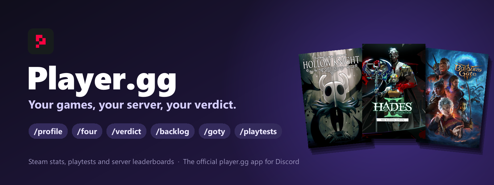

# top.gg listing: draft for the player.gg team

This is how the bot's top.gg page would read as the official player.gg app.
It's a proposal to show the player.gg team, **not submitted to top.gg**. The
live bot still describes itself as an unofficial proof of concept until
player.gg signs off.

Open this file in a Markdown preview (VS Code, GitHub) to see the page with its
images. The section between the two lines marked "paste" is the long
description to paste into top.gg.

## Form fields

| Field | Value |
|---|---|
| Bot ID | `1574183186173534369` |
| Prefix | `/` (slash commands) |
| Invite link | `https://discord.com/oauth2/authorize?client_id=1574183186173534369` |
| Website | `https://player.gg` |
| Support server | player.gg's Discord server, if there is one (top.gg doesn't require it) |
| Tags | Game, Social, Fun, Utility, Leveling (the closest five the form offers; add "steam" if custom tags are allowed) |
| Background / banner | [`topgg/banner-official.png`](topgg/banner-official.png) (1600x600; upload it, or host it on player.gg) |

## Short description (153 of 200 characters)

```
Steam stats for your server: profile cards, Four Favorites, roasts, crowns, a pile-of-shame picker and playtests. The official player.gg app for Discord.
```

## Long description

<!-- paste: start -->



**Who here actually plays Elden Ring? Who has the most hours in Deep Rock? What should we play tonight?**

The official player.gg app turns everyone's Steam library into something your server can talk about: profile cards, Four Favorites, a court that roasts your playtime, crowns for the most hours in a game, and player.gg playtests you can join before release.

**Free** · **Slash commands only** · **Works in servers, DMs and as a user app** · **No Steam password, ever**

---

## ✈️ Get started in 30 seconds

1. `/link` and sign in on Steam's own site. Player.gg only receives your Steam ID.
2. `/profile` to see your card.
3. `/four` to pick the four games that made you, then post it.

Your Steam **Game details** privacy setting needs to be **Public** for your library to load.

---

## ⚖️ /verdict: the court will see you now

An archetype and three lines of evidence, pulled from your real stats. The accused can **Appeal** for the case for the defense, and anyone watching can press **Judge me** to be next.


## ❤️ /four: Four Favorites

The four games that made you, Letterboxd style. In a server, the card shows who else here has the same favorites and who your closest match is.


## 👤 /profile and /collage

Hours played, most played, what you're playing lately, and your top games as one cover grid.


## 📚 /backlog: your pile of shame

How much of your library you've never launched, the best-known games sitting in it, and a 🎲 pick for tonight that you can reroll.


## 👑 Server competition

- `/whoplays` everyone here who owns a game, ranked by hours
- `/crowns` games where you have the most hours in the server. Play more to take someone's crown
- `/leaderboard` hours, last 2 weeks, games played, crowns and pile of shame
- `/taste` how your library and favorite genres compare with a friend's
- `/incommon` multiplayer games your whole group owns
- `/chart` the server's most played games this fortnight, optionally posted every Monday

## 🏆 /goty and /collection

Your Game of the Year race from this year's releases, with a button to vote on player.gg. Collections show how much of a list you've played, with what's left dimmed.


## 🧪 Playtests from player.gg

`/playtests` lists live and upcoming player.gg playtests you can join. Admins can run `/radar` to post new ones in a channel, with a note when a playtest fits what people in the server play.


---

## 📋 All commands

**You:** `/link` `/profile` `/four` `/verdict` `/backlog` `/iceberg` `/collage` `/goty` `/collection` `/game`
**This server:** `/whoplays` `/leaderboard` `/crowns` `/taste` `/incommon` `/chart`
**Playtests:** `/playtests` `/radar`
**Privacy and help:** `/visibility` `/unlink` `/help`

## 🔒 Privacy

- Steam sign-in happens on Steam's own site. Player.gg never sees your password.
- It reads your public Steam profile, owned games and playtime, about twice a day.
- Slash commands only: it can't read your messages, and its replies never ping anyone.
- `/visibility` hides you in any server, and `/unlink` deletes everything stored about you.
- Server installs only ask for **Manage Webhooks**, used by `/radar` and the weekly chart.

## ❓ FAQ

**Is it free?**
Yes, every feature.

**My library shows nothing.**
In Steam, go to Profile → Edit Profile → Privacy Settings and set **Game details** to **Public**. It syncs again within a few minutes.

**Can I use it without adding it to a server?**
Yes. Add it as a user app and use it anywhere, including DMs.

**Do I need a player.gg account?**
No. Link Steam and every command works. A player.gg account adds your shelf, reviews and playtest invites.

## 🔗 Links

- [Add Player.gg to Discord](https://discord.com/oauth2/authorize?client_id=1574183186173534369)
- [Create your player.gg account](https://player.gg/join)
- [player.gg](https://player.gg)

<!-- paste: end -->

## Before it goes live

- Host the banner somewhere public (top.gg needs a URL, or upload it as the page background) and point the first image at it.
- Swap the bot's Discord description and its privacy and terms pages from "unofficial proof of concept" to the official wording, and point Website and Support at player.gg's own pages.
- The card screenshots and cover images are served by the bot at `/media/` (built with `go run ./tools/topgg`; the official banner with `-banner-only -banner banner-official.png -footer "..."`, written to `docs/topgg/`).

## How this was shaped

Patterns from popular listings in the same space (November 2026):

- **.fmbot** (1.06M servers, music stats, the model for this bot): one-line pitch, "connect an account to get started", emoji-headed feature and social sections, and links.
- **Soova** (1.87K votes, Steam game nights): opens with a question, one section per feature with an example of the output, a privacy and safety section, "setup takes a minute" steps and an FAQ. Uses a background banner.
- **FreeStuff** (268K servers, free games): "easy to set up", a getting-started checklist, keyword tags and a screenshot of what its posts look like.
